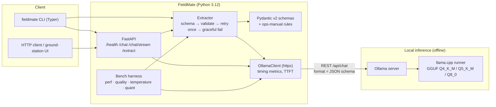
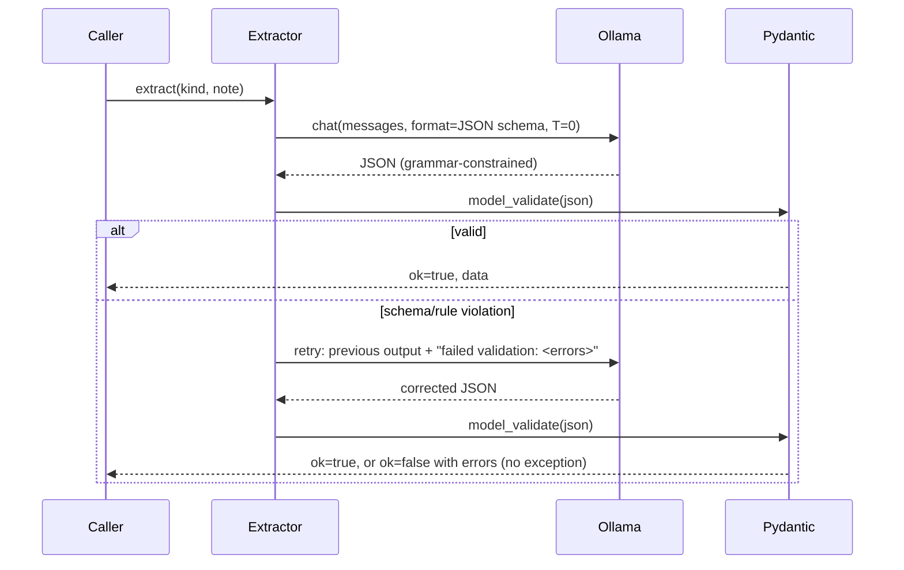
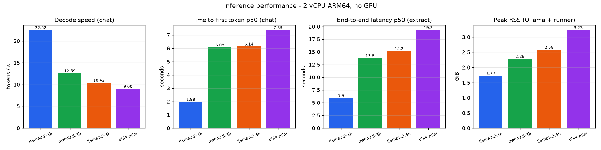
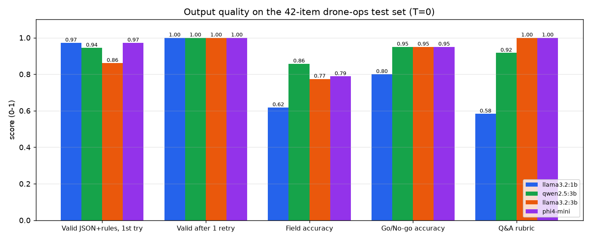
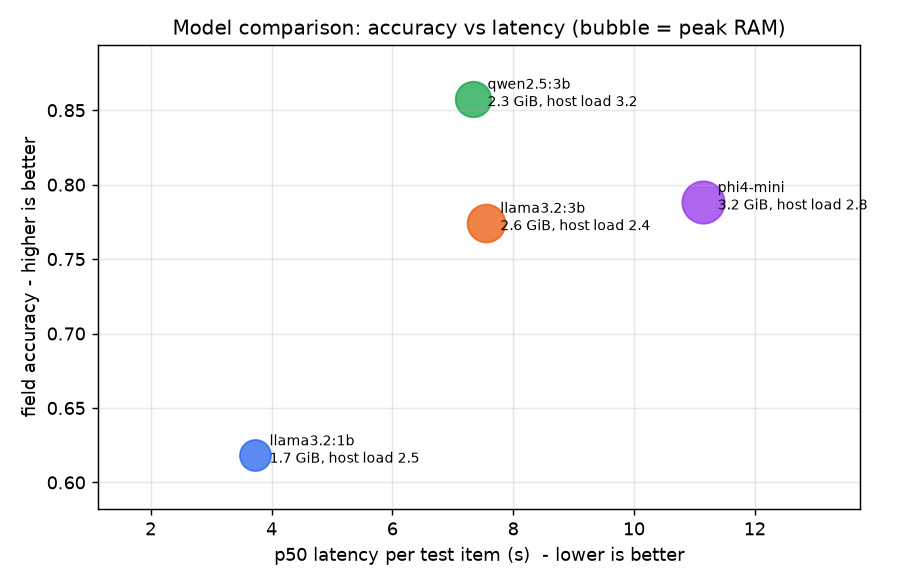
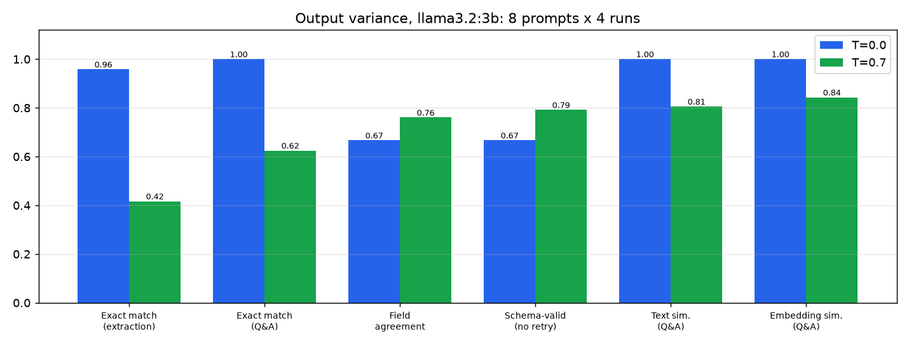
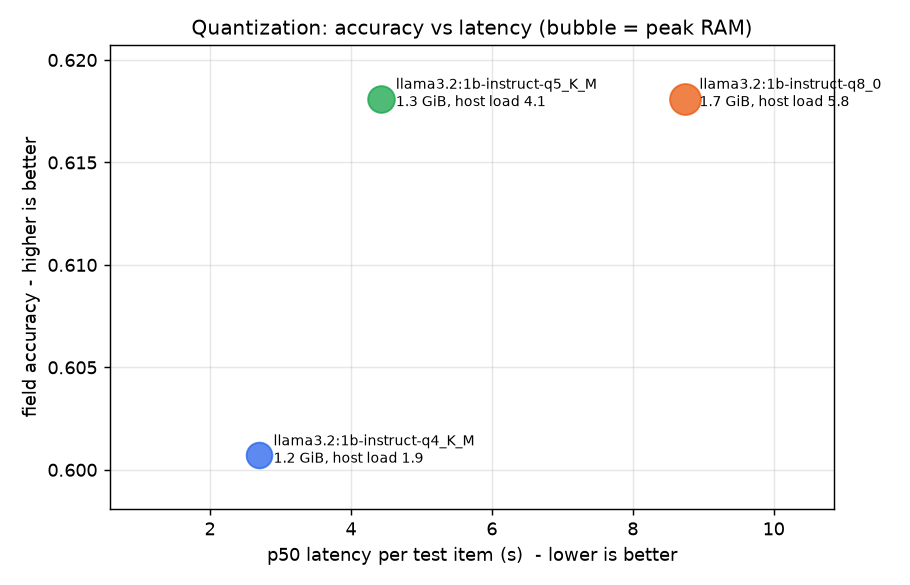

# FieldMate: an offline drone-ops assistant on small language models

<!-- links -->
[](https://github.com/burlarakesh1458-sys/fieldmate-local-slm-assistant/actions/workflows/ci.yml) **Live demo:** <http://rakeshburla.dpdns.org/fieldmate-local-slm-assistant/> · **Code:** <https://github.com/burlarakesh1458-sys/fieldmate-local-slm-assistant> · **Resume bullets:** [RESUME_BULLETS.md](RESUME_BULLETS.md) · **License:** MIT

FieldMate turns a drone pilot's messy field notes into **validated JSON** (pre-flight go/no-go
checks, maintenance defect reports) and answers questions about a fleet log. It runs **entirely
offline** on small language models (1B to 4B parameters) served by [Ollama](https://ollama.com):
no API key, no network, no data leaving the laptop or ground-station box.

The repo is also a **benchmark study**. Every number below was measured on a 2-vCPU ARM64
machine with no GPU, using the harness in `src/fieldmate/bench/`. Nothing is estimated.

> Built by Rakesh Burla (B.Tech Mechanical, RGUKT Basar), who works on drones/UAVs.
> Project 2 of an AI-engineering portfolio: local inference, structured output, model selection.

## Why offline?

Drone field teams work where connectivity is bad: agricultural survey sites, disaster zones,
ranges and campuses with patchy mobile data. Flight logs can be sensitive (locations, client
sites, defence/aerospace work), so sending them to a cloud LLM may not be allowed. At the end of
a day of flying, a crew has 30 to 100 scribbled notes like:

```
pre-flt Q4-ALPHA. prop #3 has a nick on leading edge. batt 88. gps fine. didnt check compass.
```

FieldMate turns that into a record the maintenance system can trust:

```json
{"aircraft_id": "Q4-ALPHA", "battery_pct": 88, "propellers": "issue", "motors": "ok",
 "gps": "ok", "compass": "not_checked", "weather_ok": true, "decision": "no_go",
 "issues": ["nick on leading edge of prop #3"]}
```

The model's output is constrained by a JSON schema and validated against the ops manual (for
example: any propeller issue forces `no_go`; a `high` or `critical` defect must ground the
aircraft). Output that breaks a rule is sent back to the model once, with the error, before the
call fails gracefully.

## Architecture



Extraction flow:



## Results (measured, 2-vCPU ARM64, no GPU)

All tables are generated by `scripts/make_tables.py` from the raw files in `results/`; the full
set, including per-field accuracy, is in [`docs/RESULTS_TABLES.md`](docs/RESULTS_TABLES.md) and
the analysis in [`docs/REPORT.md`](docs/REPORT.md). The host was shared with other jobs, so each
table shows the 1-minute load average next to the numbers.

### Speed (5 warm runs per prompt type, 128-token cap, T=0)

| Model | Decode tok/s | TTFT chat p50 (s) | TTFT extraction mean (s) | Extraction latency p50 / p95 (s) | Cold load (s) | Peak RSS (GiB) |
|---|---|---|---|---|---|---|
| `llama3.2:1b` (Q8_0) | **22.5** | **1.98** | **3.1** | **5.9 / 6.1** | 16.8 | **1.73** |
| `qwen2.5:3b` (Q4_K_M) | 12.6 | 6.08 | 9.8 | 13.8 / 15.0 | 33.1 | 2.28 |
| `llama3.2:3b` (Q4_K_M) | 10.4 | 6.14 | 13.1 | 15.2 / 41.5 | 37.4 | 2.58 |
| `phi4-mini` 3.8B (Q4_K_M) | 9.0 | 7.39 | 12.6 | 19.3 / 21.4 | 49.5 | 3.23 |



### Quality on the 42-item test set (T=0, schema-constrained, 1 retry)

| Model | Valid 1st try | Valid after retry | Field accuracy | Go/No-go | Defect severity | Q&A rubric | p50 s/item |
|---|---|---|---|---|---|---|---|
| `llama3.2:1b` | 97.2% | 100% | 61.8% | 80.0% | 18.8% | 58.3% | **3.7** |
| `qwen2.5:3b` | 94.4% | 100% | **85.8%** | **95.0%** | 62.5% | 91.7% | 7.3 |
| `llama3.2:3b` | 86.1% | 100% | 77.4% | **95.0%** | 62.5% | **100%** | 7.5 |
| `phi4-mini` | 97.2% | 100% | 78.8% | **95.0%** | **68.8%** | **100%** | 11.1 |




**Every model produced 100% schema-valid output after at most one retry** (36 extraction items
each, 144 extractions in total). Validity is not the hard part; getting the *fields* right is.
`qwen2.5:3b` is the best extractor (85.8% field accuracy, +24 points over the 1B model) at half
the latency of `phi4-mini`. `llama3.2:3b` and `phi4-mini` answer fleet-log questions perfectly
but mis-copy aircraft ids on defect notes (62.5%).

### Temperature: same 8 prompts x 4 runs (`llama3.2:3b`, no retry)

| Metric | T=0 | T=0.7 |
|---|---|---|
| Identical outputs, extraction | 95.8% | 41.7% |
| Identical outputs, Q&A | 100% | 62.5% |
| Field-accuracy std-dev across runs | 0.000 | 0.151 |
| Pairwise text similarity, Q&A | 1.000 | 0.805 |
| Embedding similarity, Q&A (all-minilm) | 1.000 | 0.843 |
| Schema-valid without retry | 66.7% | 79.2% |



At T=0 the model gave the same answer almost every time (31 of 32 runs matched the most common output; the one
exception, on one note, is most likely llama.cpp prompt-cache/batching non-determinism), and its mistakes were just as
repeatable: two of the six notes failed validation on all four runs. At T=0.7 only 42% of
extraction runs matched and field accuracy swung by 0.15 (std-dev) from run to run. T=0.7 scored
slightly higher here (79% vs 67% valid without retry) because sampling sometimes escaped the
repeatable mistakes, but on 6 notes that is noise, and the retry loop fixes those cases at T=0
(100% valid). Extraction stays at T=0 for reproducible records.

### Constrained vs unconstrained decoding (`llama3.2:1b`, all 42 items)

| Decoding | Valid 1st try | Valid after retry | Field accuracy | Go/No-go | p50 s/item |
|---|---|---|---|---|---|
| JSON schema as `format` (grammar) | **97.2%** | **100%** | **61.8%** | **80.0%** | **3.7** |
| `format="json"`, schema only in the prompt | 47.2% | 69.4% | 51.0% | 60.0% | 7.8 |

Without the grammar, 53% of extractions needed the retry and 31% still failed (wrong enum values
such as `component`, `issues` as a string, ops-rule violations), and the retries doubled the
median latency. One twist: on the 25 outputs that *were* valid, the unconstrained model got 73.5%
of fields right and read the battery level correctly 15 times out of 15, while the constrained
model returned `null` battery on 20 of 20 pre-flight notes. The grammar guarantees shape, but it
also makes "null" the easiest path for a tiny model (see the report).

### Quantization (`llama3.2:1b`, same 42 items)

| Build | File size | Peak RSS (GiB) | Decode tok/s (host load) | Field accuracy | Go/No-go | Q&A rubric (6 items) |
|---|---|---|---|---|---|---|
| Q4_K_M | 770 MiB | **1.19** | **30.1** (2.1) | 60.1% | 80.0% | 25.0% |
| Q5_K_M | 869 MiB | 1.29 | 13.9 (4.4) | 61.8% | 75.0% | 33.3% |
| Q8_0 | 1,259 MiB | 1.72 | 22.5 (0.3) / 14.4 (5.9) | 61.8% | 80.0% | 58.3% |

Q4_K_M uses **31% less RAM** than Q8_0 and lost **1.7 points** of field accuracy; Q5_K_M lost
nothing on extraction. The free-text Q&A answers degraded much more (58% to 25% of rubric facts),
though on only 6 questions. Speed numbers are confounded by the shared host (the load average is
in brackets): Q4_K_M at load 2.1 still decoded 34% faster than Q8_0 at load 0.3. Re-running Q8_0
reproduced all 36 extraction outputs of the main study exactly, so T=0 accuracy is reproducible.



### Which model should a field team run?

* **Default: `qwen2.5:3b`** (now the FieldMate default). Best field accuracy (85.8%), 95% go/no-go,
  2.3 GiB RAM, about 7 s per note on 2 CPU cores.
* **Q&A-heavy use: `phi4-mini` or `llama3.2:3b`**: 100% on the fleet-log questions, but more RAM
  (3.2 / 2.6 GiB) and weaker on aircraft ids in defect notes.
* **`llama3.2:1b`** only on boards with under 2 GiB free, and only with a human reviewing
  every no-go decision: it gets one go/no-go call in five wrong.
* **`mistral:7b` was not benchmarked.** Its 4.1 GB of weights plus KV cache did not fit next to
  the other workloads on the 7.8 GiB, swap-less box; this is recorded as an exclusion, not a result.

## Features

| | |
|---|---|
| **Offline inference** | Ollama + GGUF small language models, CPU only. httpx client with `trust_env=False`, so local traffic never goes through a proxy. |
| **Structured extraction** | `PreflightReport` and `DefectReport` Pydantic v2 schemas. The JSON schema is passed as Ollama `format`, so decoding is grammar-constrained. |
| **Ops-manual validation** | Rules no grammar can express, written as `model_validator`s: no-go on any issue, battery below 30% or bad weather; high/critical defects ground the aircraft. |
| **Retry with error feedback** | On a parse or validation error the model sees its own output plus the exact Pydantic errors, and gets **one** retry. After that `ok=false` is returned: no exception, no crash. |
| **Grounded Q&A** | `/chat` answers from a fleet log you pass in, and says "not in the log" otherwise. |
| **Streaming** | `/chat/stream` (NDJSON) and the CLI print tokens as they arrive. Client-side TTFT is measured. |
| **Benchmark suite** | Perf (TTFT, tok/s, p50/p95 latency, peak RSS), quality (validity, field accuracy, rubric), temperature variance, a constrained-decoding ablation and a quantization study. Runs are resumable and wait for free RAM. |
| **Ops-ready** | Typer CLI, FastAPI with OpenAPI docs, Dockerfile, docker-compose (app + ollama + model-init), Makefile, ruff, a pytest suite that runs offline. |

## Quickstart

```bash
# 1. Ollama + a model (once, needs internet; fully offline afterwards)
curl -fsSL https://ollama.com/install.sh | sh
ollama serve &                      # or the desktop app
ollama pull qwen2.5:3b

# 2. FieldMate
python -m venv .venv && source .venv/bin/activate
make dev                            # pinned deps + editable install
fieldmate health

# 3. Use it
fieldmate extract preflight "uav-07 batt 92%, props ok, gps 14 sats, compass ok, motors ok, wind 8 km/h"
fieldmate extract defect "AERO-2 battery pack B3 puffed up a bit after charge, smells weird"
fieldmate chat "Which aircraft are grounded?" --context examples/fleet_log.txt --stats

# 4. API
fieldmate serve                     # http://127.0.0.1:8000/docs
curl -s localhost:8000/extract -H 'content-type: application/json' \
  -d '{"kind":"defect","text":"UAV-03 hairline crack at base of rear right arm"}'
curl -N localhost:8000/chat/stream -H 'content-type: application/json' \
  -d '{"message":"How should a swollen LiPo be handled?"}'
```

Docker (app + Ollama + one-shot model pull):

```bash
docker compose up -d --build        # FIELDMATE_MODEL=qwen2.5:3b by default
curl localhost:8000/health
```

Configuration (environment variables): `OLLAMA_HOST` (default `http://127.0.0.1:11434`),
`FIELDMATE_MODEL` (default `qwen2.5:3b`), `FIELDMATE_TEMPERATURE` (0), `FIELDMATE_NUM_CTX`
(2048), `FIELDMATE_MAX_RETRIES` (1), `FIELDMATE_TIMEOUT_S` (300), `FIELDMATE_USE_MMAP` (0).

### API

| Method | Path | Body | Returns |
|---|---|---|---|
| GET | `/health` | | Ollama version, local models, whether the default model is present (503 if Ollama is down) |
| POST | `/chat` | `{message, context?, model?, temperature?}` | `{answer, model, metrics}` |
| POST | `/chat/stream` | same | NDJSON: `{"delta": ...}` lines, then `{"done": true, "metrics": {...}}` |
| POST | `/extract` | `{kind: preflight\|defect, text, model?, temperature?}` | `ExtractionResult`: `ok`, `data`, every attempt with its raw output, error and timings |

`/extract` returns **200 with `ok=false`** when the model cannot produce valid output after the
retry (the caller decides what to do next, such as sending the note to a human), and **502**
only when Ollama itself is unreachable.

### Reproduce the benchmarks

```bash
make pull                           # models used below + all-minilm for embeddings
make bench                          # or: scripts/run_benchmarks.sh (RAM-gated, resumable)
python scripts/make_tables.py > docs/RESULTS_TABLES.md
fieldmate bench charts
```

## Repository layout

```
src/fieldmate/
  client.py        Ollama REST client: chat, stream (TTFT), embed, unload; timing metrics
  schemas.py       Pydantic v2 contracts + ops-manual validators
  prompts.py       system prompts, field specs, repair prompt
  extractor.py     constrained generation -> validate -> 1 retry -> graceful failure
  api.py / cli.py  FastAPI service and Typer CLI
  bench/           perf.py, quality.py, temperature.py, scoring.py, charts.py, common.py
data/testset.jsonl 42 hand-labelled items (20 pre-flight, 16 defect, 6 fleet-log Q&A)
results/           raw per-run JSONL + summaries (committed, so every number can be audited)
docs/REPORT.md     technical report;  docs/charts/*.png
scripts/           run_benchmarks.sh, wait_for_memory.py, make_tables.py
tests/             36 offline tests (httpx.MockTransport fake Ollama)
```

## Design decisions

* **Grammar-constrained decoding first, validation second.** Ollama's `format` accepts a JSON
  schema and turns it into a llama.cpp grammar, so the model *cannot* emit a missing brace or an
  unknown enum value. Pydantic then checks what no grammar can express (the ops-manual rules).
  The ablation below measures what the schema constraint is worth on its own.
* **One retry, then fail gracefully.** A second retry rarely helps a small model and doubles the
  worst-case latency on a CPU box. `ok=false` plus the raw attempts lets the caller route the
  note to a human instead of crashing a batch job.
* **T=0 and a fixed seed for extraction.** Field records have to be reproducible; the temperature
  study shows what T=0.7 costs.
* **`num_ctx=2048`, one loaded model, one slot.** On a 7.8 GiB box without swap, KV-cache RAM
  matters more than long context. Every prompt in the test set fits in 2048 tokens.
* **No example values in prompts.** Tiny models copy them (see "What went wrong").
* **httpx with `trust_env=False`.** Local inference traffic never touches a proxy.
* **Everything resumable and RAM-gated.** Results are appended row by row; a model only loads when
  three readings in a row show enough free RAM. On a shared edge box this is what made the study
  finish at all.
* **Committed raw results.** `results/*.jsonl` holds every model output, so every table can be
  audited and regenerated with `scripts/make_tables.py`.

## What went wrong, and the fixes

1. **The runner was OOM-killed on a shared 7.8 GiB box.** Ollama on CPU turns mmap *off* and
   copies the weights into process memory, and llama.cpp's ARM weight repacking makes another
   resident copy. `llama3.2:1b` (Q8_0, 1.3 GB on disk) reached 1.7 GB anonymous RSS, and the
   kernel log shows `Out of memory: Killed process ... (llama-server)`. Other jobs on the box held
   up to 5 GiB of RAM-backed `/tmp`, so free memory moved between 0.1 and 2.9 GiB from minute to
   minute. *Fixes:* (a) `scripts/wait_for_memory.py` only loads a model after three readings in a
   row, 10 s apart, show enough free RAM for it (one good reading was not enough: a load passed
   the gate at 2.9 GiB and was still killed); (b) a circuit breaker stops a model's run after two
   Ollama errors in a row instead of writing 42 rows of failures; (c) every result row is
   appended to JSONL as soon as it exists, so a run that gets killed resumes where it stopped;
   (d) `LLAMA_ARG_CACHE_RAM=0` turns off llama-server's 8 GiB host prompt cache.
2. **mmap is not a free lunch.** I tried `use_mmap=true` with repacking off, so the weights live
   in reclaimable page cache. Under memory pressure the kernel kept evicting them and re-reading
   them over the network filesystem: about 1 token/s, and a 284-token prompt took minutes to
   pre-fill. The mode stays available as `FIELDMATE_USE_MMAP=1` for hosts that have the RAM, but
   it is off by default. Lesson: on an edge box, budget RAM for the whole model plus about
   0.5 GiB. Do not count on paging.
3. **The 1B model copied the example from the prompt.** The first system prompt said
   "Aircraft IDs are upper-case like UAV-07". `llama3.2:1b` then labelled a Q4-ALPHA note as
   UAV-07. I changed the example to `XY-12`, and the model wrote `XY-12` for every defect.
   *Fix:* no example values in prompts for tiny models. The instruction now says "copy the
   aircraft ID from the note". Both prompt versions are in git history.
4. **Local traffic went through a proxy.** The sandbox sets `HTTP(S)_PROXY`, and httpx honours it
   by default, so requests to `127.0.0.1:11434` came back empty. *Fix:* the client uses
   `trust_env=False`. An offline tool should never send local inference traffic through a proxy.
5. **Identical prompts made TTFT look too good.** In early runs every warm request reused the
   first one's KV cache (prefill showed about 1,000 tok/s). *Fix:* each warm run now uses a
   different question or note, so only the shared system prompt is cached, as in real use.
6. **`pgrep -f` killed my own shell.** Housekeeping scripts that matched on the command line
   also matched the shell running them. `scripts/` now matches on exact process names. A small
   thing, but it cost several reruns.
7. **The RAM gate waited for memory the previous model was holding.** With `keep_alive=30m`,
   `phi4-mini`'s runner (3.3 GB resident) stayed loaded after its quality run, so the gate for
   the next model (needs 2.7 GiB free) saw about 2.7 GiB and kept waiting, while the box sat
   idle. *Fix:* `scripts/wait_for_memory.py` now asks Ollama to unload any resident model
   (`keep_alive: 0`) before it starts counting free RAM.
8. **Nullable fields became an escape hatch.** The schema allows `battery_pct` and
   `weather_ok` to be `null` ("not stated"). Under grammar-constrained decoding the models,
   above all the 1B one, often chose `null` even when the note said "batt 88": `llama3.2:1b`
   returned `null` battery on 20 of 20 pre-flight notes. This was found by the per-field table,
   not by the headline validity number (100% valid after retry). It is reported as measured, not
   fixed after the fact; see future work.

## Future work

* Fine-tune (LoRA) a 1B model on synthetic pilot notes so the smallest model closes the accuracy
  gap with the 3B models; distil from a larger model's outputs.
* Run the same harness on real edge hardware (Raspberry Pi 5, Jetson Orin Nano) and with GPU
  offload, without other jobs sharing the CPU.
* Add `mistral:7b` and other 7-8B models on a machine with more than 8 GiB of RAM (excluded here:
  4.1 GB of weights plus KV cache did not fit next to the other workloads on the box).
* Grow the test set past 42 items, add inter-annotator labels, and report confidence intervals.
* Speculative decoding (1B draft for a 3B target) to cut latency on CPU.
* A small offline UI for the ground station and a sync queue for when connectivity returns.

## License

MIT, see [LICENSE](LICENSE).
